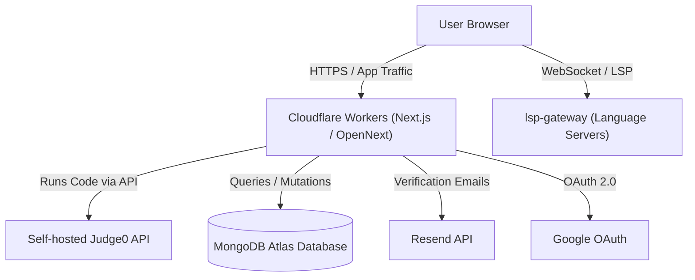

# Architecture Overview

This document describes the high-level architecture of the Coding Club platform and how its components interact.

---

## System Overview



The system consists of three main sub-projects and external services:

1. **`ActualSite/my-app`**: The core web application built with Next.js (App Router) and deployed to Cloudflare Workers via the [OpenNext Cloudflare adapter](https://opennext.js.org/cloudflare).
2. **`lsp-gateway/`**: A WebSocket gateway communicating with per-language language servers (Python, C/C++, Rust, Go, Java) to provide real-time IntelliSense diagnostics and completions in the Monaco code editor.
3. **`local-dev-tools/`**: Docker Compose configuration enabling members to run their own local IntelliSense backend. Bundled automatically into a downloadable zip on the site's Resources page.
4. **Judge0 Instance**: A self-hosted instance of Judge0 used for sandboxed code execution and automated test runner evaluation.
5. **MongoDB Atlas**: Cloud database storing user profiles, authentication sessions/verification codes, coding challenges, and completed problem solves.

---

## Directory Structure

```text
Coding-Club-Site/
├── ActualSite/
│   └── my-app/               # Next.js web application
│       ├── app/              # App Router pages and API routes
│       │   ├── api/
│       │   │   ├── auth/     # Signup, login, verify, password reset, OAuth
│       │   │   └── run/      # Proxy route to Judge0 runner
│       │   ├── account/      # Member profile & solve history
│       │   ├── problems/     # Coding challenges & editor interface
│       │   └── resources/    # Club resources & local tools download
│       ├── components/       # Shared UI components (Auth, Editor, Navbar, etc.)
│       ├── lib/              # Client and server utility libraries
│       │   ├── judge/        # Test runner & language configurations
│       │   ├── mongodb.js    # Per-request MongoDB connection handler
│       │   └── session.js    # Signed cookie session management
│       ├── data/             # Static resource definitions & starter challenges
│       └── scripts/          # DB setup, seed, validation & build scripts
├── lsp-gateway/              # Language Server Protocol WebSocket gateway
├── local-dev-tools/          # Docker Compose definitions for local IntelliSense
└── docs/                     # Project documentation
```

---

## Key Design Patterns & Constraints

### Cloudflare Workers Runtime
The web app executes inside Cloudflare Workers using OpenNext.
- **Stateless Connections**: Database connections cannot be pooled across requests globally. `lib/mongodb.js` uses `withDb(fn)` to open, execute, and cleanly close connections per request.
- **Free Plan CPU Limit**: Password hashing rounds use PBKDF2 with 30,000 iterations plus a secret pepper (`PASSWORD_PEPPER`) to stay safely within CPU execution limits while maintaining cryptographic security.

### Code Execution vs. IntelliSense
- **Code Execution**: Always runs against the hosted Judge0 server via `app/api/run`. Judge0 relies on Linux cgroup v1, which prevents it from being containerized on modern WSL2 / Windows environments.
- **IntelliSense**: Powered by `lsp-gateway`. Users can toggle between our hosted gateway and a local containerized gateway in the site's Run Settings panel without affecting the code runner.
